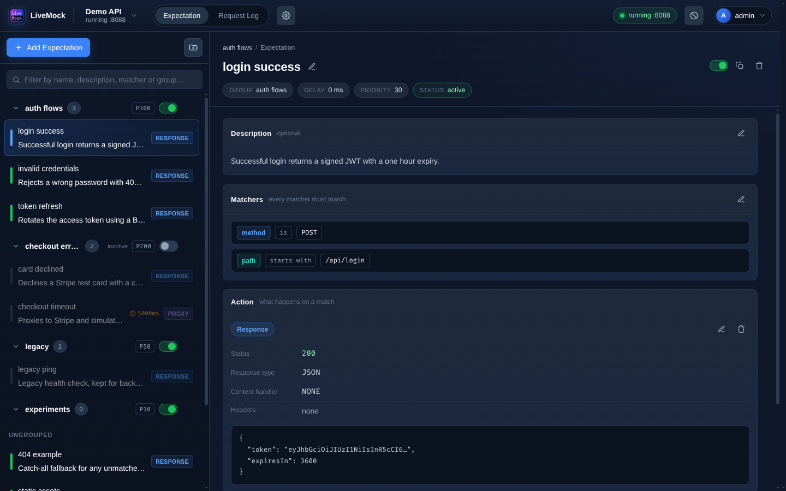
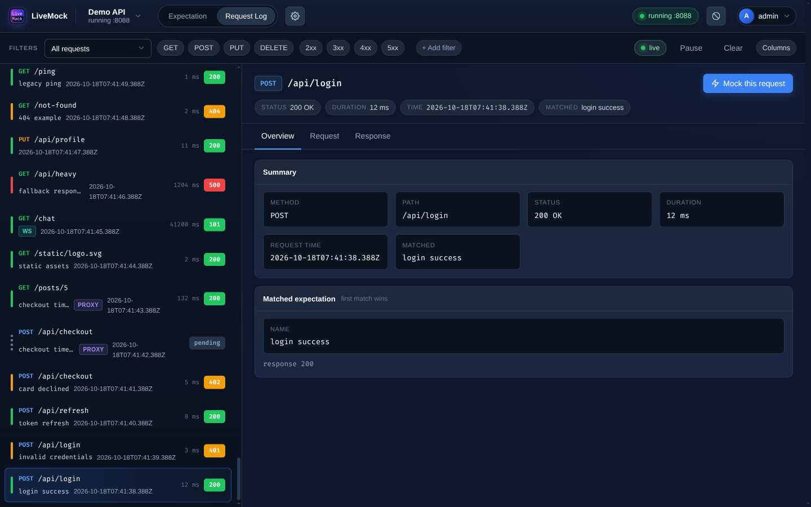
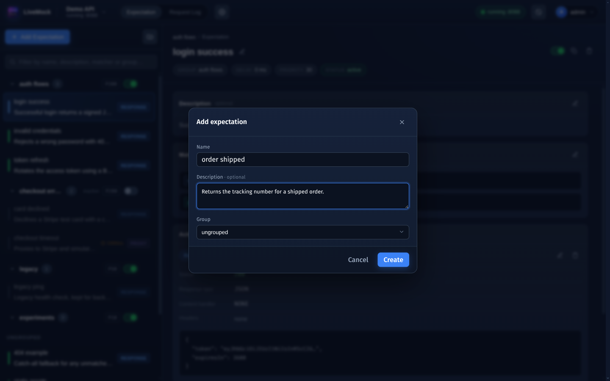

<p align="center">
  
</p>

<h1 align="center">
    LiveMock
</h1>
<h3 align="center">
  <a href="https://alingmail.github.io/LiveMockDoc/docs/intro">📚文档（英文）</a>
</h3>

<p align="center">
  <a href="./README.md">English</a> | <strong>简体中文</strong>
</p>

LiveMock 是一套面向 API 开发与测试的完整工具：它提供 mock 数据、请求代理和日志记录，用来简化工作流并追踪流量。

## 🎆 预览




## 📦 功能

* **动态 mock**：修改 mock 后立即生效，无需重启服务
* **基于浏览器**：dashboard 由服务本身提供，在任何现代浏览器中打开即可使用
* **支持 API 代理**：需要时将请求转发到真实 API
* **支持 mockjs**：用 mockjs 库生成 mock 数据
* **日志与分析**：记录请求与响应，便于分析

## 🚧 安装

### 从 npm 安装

后端与 dashboard 已经以 npm 包 [`livemock`](https://www.npmjs.com/package/livemock) 的形式发布，无需克隆仓库或构建，直接从 registry 运行即可：

```
npx livemock
```

或者全局安装，让 `livemock` 命令常驻 `PATH`：
```
npm install -g livemock
livemock
```

两种方式启动后，服务都监听 **http://localhost:9002**（dashboard 位于 `/dashboard`），并在当前工作目录下创建 `db` 目录。若想把数据放到别处，可以在目标目录中启动，或用 `LIVEMOCK_DB_PATH` 指向一个绝对路径：

```
LIVEMOCK_DB_PATH=/var/lib/livemock npx livemock
```

> [!NOTE]
> 需要 Node.js 18 或更高版本。下次运行 `npx livemock` 时 npm 会复用缓存副本；加上 `@latest`（即 `npx livemock@latest`）才会拉取更新的版本。

<details>
<summary>改用源码安装（用于贡献 / 开发）</summary>

#### 1. 本项目使用 Yarn Workspaces，需要先启用 corepack。
```
corepack enable
```

#### 2. 克隆项目
```
git clone https://github.com/alinGmail/LiveMock.git
```

#### 3. 安装依赖
```
cd LiveMock
yarn install
```

> [!NOTE]
> 如果你在中国大陆，可以设置 ELECTRON_MIRROR 环境变量为 https://npmmirror.com/mirrors/electron/
>

#### 4. 构建前端代码
```
yarn run web-build
```

#### 5. 运行项目
```
yarn run web-start
```
服务默认运行在 http://localhost:9002

</details>

#### 配置
| 环境变量 | 默认值 | 说明 |
|---|---|---|
| `LIVEMOCK_PORT` | `9002` | web 服务监听的端口 |
| `LIVEMOCK_DB_PATH` | `db` | 数据库文件所在的目录 |
| `LIVEMOCK_COOKIE_SECURE` | `false` | dashboard 通过 HTTPS 提供服务时设为 `true`，这样会话 cookie 只会经 TLS 发送（HTTPS 本身由你的反向代理终止） |
| `LIVEMOCK_TRUST_PROXY` | *（未设置）* | 以逗号分隔的反向代理 IP/CIDR 列表，其 `X-Forwarded-For` 头会被信任（例如 `127.0.0.1,10.0.0.0/8`）。不设置或设为 `false` 时完全忽略转发头。故意不提供“信任所有来源”模式；条目非法会导致服务在启动时退出 |

例如，换一个端口运行：
```
LIVEMOCK_PORT=8100 npx livemock
```
（在源码仓库中运行时，改用 `LIVEMOCK_PORT=8100 yarn run web-start`。）

控制面(control plane) API 位于 `/api` 之下（例如 `http://localhost:9002/api/project/`），Socket.IO 端点是 `/api/socket.io`。开发模式（`yarn web-dev`）下，前端使用相对 URL，Vite 开发服务器会把 `/api`（含 WebSocket upgrade）代理到后端，因此不需要配置服务地址；生产模式下，后端在同源的 `/dashboard` 提供 UI。

使用 Docker Compose 时，同一个变量同时控制监听端口和发布端口：
```
LIVEMOCK_PORT=8100 docker compose up
```

### 认证

LiveMock 由**单一账号**保护。

- **首次运行：** 第一次访问会显示初始化表单。创建账号（用户名 + 密码）后即自动登录。此后注册端点永久关闭，每次访问都需要登录。
- **会话：** 登录状态保存在 httpOnly cookie 中，只要 7 天内有活动就一直有效，后端重启也不会失效。登出只结束当前会话，因此可以同时在多台设备上保持登录。
- **保护范围：** dashboard、所有 `/api` 端点以及 Socket.IO 连接都需要登录。mock 监听端口（例如 `http://localhost:8088`）保持公开，这样被 mock 的 API 和测试客户端照常可用。
- **暴力破解：** 同一 IP 的连续登录失败会指数级退避，上限 30 分钟。账号本身永远不会被锁定。
- **修改密码**在 `Config` 页面进行，会结束其他所有会话。
- **公网部署：** 启动服务后请立即注册——第一个调用注册接口的人就拥有该账号。按设计没有初始化令牌。部署在反向代理之后时，请设置 `LIVEMOCK_TRUST_PROXY`，让登录限流看到真实客户端 IP；通过 HTTPS 提供服务时再设置 `LIVEMOCK_COOKIE_SECURE=true`。

如果忘记了凭据，请先停止后端，然后运行：
```
npx livemock reset-admin <new-username>
```
全局安装时使用 `livemock reset-admin <new-username>`，源码仓库中则使用 `yarn workspace livemock reset-admin <new-username>`。系统会两次提示输入新密码（输入不回显）。该命令会重置用户名和密码，并使所有会话失效；重新启动后端后登录即可。必须先停止后端，因为服务运行期间数据库是从内存写入的。

使用 Docker Compose 时，这些可选设置可以通过环境变量传入：
```
LIVEMOCK_COOKIE_SECURE=true LIVEMOCK_TRUST_PROXY=127.0.0.1 docker compose up
```

### MCP server

LiveMock 附带一个独立的 MCP server：[`livemock-mcp`](mcp/README.zh-CN.md)。通过它，Claude Code、Claude Desktop、Cursor 等 AI 客户端可以在编辑器里管理项目(project)、expectation、分组(group)和请求记录(request log)。

1. 打开 **Settings → API tokens**，创建一个带名字的令牌(token)。令牌只显示一次，请立即复制；LiveMock 只保存它的哈希。
2. 把 MCP server 指向正在运行的 web 实例：

```bash
LIVEMOCK_URL=http://localhost:9002 \
LIVEMOCK_API_TOKEN=lmk_replace_me \
npx -y livemock-mcp
```

或者让 [`add-mcp`](https://github.com/neon-solutions/add-mcp) 写入用户级客户端配置：

```bash
npx add-mcp@2 livemock-mcp -g -a claude-code \
  --env 'LIVEMOCK_URL=http://localhost:9002' \
  --env 'LIVEMOCK_API_TOKEN=${LIVEMOCK_API_TOKEN}'
```

`add-mcp` 会提示输入令牌，并推断服务器名称为 `livemock`；通过 `-a` 还支持 Cursor、OpenCode、Claude Desktop 等客户端。请保留 `-g`，这样令牌不会被写进项目文件；完整的安装说明见 [`mcp/README.zh-CN.md`](mcp/README.zh-CN.md)。

令牌拥有数据面的完整权限，但不能创建或吊销其他令牌，也不能修改账号密码。修改密码或运行 `livemock reset-admin` 会吊销所有令牌。客户端配置、工具清单和原始 expectation 示例见 [`mcp/README.zh-CN.md`](mcp/README.zh-CN.md)。

## 📌快速开始
安装完成后，首次访问会要求你为实例创建账号。之后登录即可进入欢迎页（用于创建项目的页面）。填写项目名并提交表单，就会跳转到 dashboard。

### 创建 expectation
expectation 由若干 matcher 和一个 action 组成。当请求命中它的全部 matcher 时，就会执行定义好的 action，例如返回一段 JSON。

要创建 expectation，点击 `Add Expectation` 按钮。之后你会在列表中看到刚创建的 expectation。

### 创建 matcher
要创建 matcher，点击 `Add Matcher` 按钮。把 matcher 改为 `path start_with /` 即可命中所有请求。

### 创建 action
action 定义 expectation 会做什么。目前支持三种 action：自定义响应(custom response)、proxy 和静态目录(static directory)。

要创建 action，点击 `Create Action` 按钮。默认的 action 类型是自定义响应，你可以把它改成 proxy。action 创建好后，点击它，在内容字段中输入所需的 JSON 字符串，内容会自动保存。

### 启动项目
在页面顶部可以找到一个绿色的启动按钮。点击它即可启动项目。另外请确保你的 expectation 处于启用状态。之后访问 http://localhost:8088 就能看到 JSON 响应。

## 🧱文档
### expectation 是什么
expectation 由若干 matcher 和一个 action 组成。当请求命中它的全部 matcher 时，就会执行定义好的 action，例如返回一段 JSON。

### 如何创建 expectation
要创建 expectation，请进入 expectation 列表页面，点击 `Add Expectation` 按钮。之后你会在列表中看到刚创建的 expectation。

### expectation 的属性
- `delay`：响应延迟，单位是毫秒。
- `priority`：优先级(priority)更高的 expectation 会先被匹配。
- `activate`：如果 expectation 处于停用状态，匹配请求时会被跳过。
- `matchers`：expectation 的 matcher 集合；请求命中全部 matcher 时，才会执行该 expectation 的 action。
- `action`：expectation 的 action，目前支持三种：自定义响应(custom response)、proxy 和静态目录(static directory)。

### matchers
matcher 由三部分组成：类型(type)、比较器(comparator)和值(value)。这三部分共同决定一个请求能否被匹配。
目前 LiveMock 支持五种类型：

- `method`：请求方法，例如 GET、POST、PUT 等。
- `path`：请求路径，以 `/` 开头，例如 `/student/123`。
- `header`：请求头。
- `query`：请求 URL 中的参数。
- `param`：请求体中的参数。

下面是一些 matcher 的示例：
- `path START_WITH /book/`：匹配所有以 `/book/` 开头的请求路径。
- `query teacher_name CONTAINS tom`：匹配所有带有 `teacher_name` 查询参数、且该参数值包含 "tom" 的请求。
- `param teacher_name IS tom`：匹配所有带有请求体、且请求体中有 `teacher_name` 参数且值为 `tom` 的请求。例如，请求体是这样的 JSON：
```json
{
  "teacher_name": "tom"
}
```

### action
action 有三种类型：
- `custom response`：向请求返回自定义的文本或 JSON，你也可以设置响应的 headers。
- `proxy`：把请求转发到另一个主机。
- `static`：从运行 LiveMock 的机器上的某个目录提供文件。

自定义响应和 proxy 这两种 action 都支持自定义响应头。

### 请求记录(request log)
LiveMock 会把所有命中 expectation 的请求记录为一个 JSON 对象，并显示在请求记录页面上。下面是一条记录示例：
```json
{
    "id": 100099,
    "expectationId": "c26a2cef-8ac7-4ce4-8a4b-595c850488be",
    "proxyInfo": {
      "isProxy": false,
      "proxyHost": null,
      "proxyPath": null
    },
    "req": {
        "body": { },
        "headers": {
            "host": "localhost:8088",
            "connection": "keep-alive",
            "cache-control": "max-age=0",
            "upgrade-insecure-requests": "1",
            "user-agent": "Mozilla/5.0 (Windows NT 10.0; Win64; x64) AppleWebKit/537.36 (KHTML, like Gecko) Chrome/115.0.0.0 Safari/537.36",
            "accept": "text/html,application/xhtml+xml,application/xml;q=0.9,image/avif,image/webp,image/apng,/;q=0.8,application/signed-exchange;v=b3;q=0.7",
            "accept-encoding": "gzip, deflate, br"
        },
        "method": "GET",
        "path": "/olkioi",
        "requestDate": "2023-08-04T13:14:51.042Z"
    },
    "res": {
        "body": {
            "name": "John",
            "age": 30,
            "hobbies": [
                "reading",
                "hiking",
                "coding"
            ]
        },
        "duration": 0,
        "headers": {
            "x-powered-by": "Express",
            "content-type": "text/plain"
        },
        "rawBody": "{\"name\":\"John\",\"age\":30,\"hobbies\":[\"reading\",\"hiking\",\"coding\"]}",
        "responseDate": "2023-08-04T13:14:51.042Z",
        "status": 200,
        "statusMessage": "OK"
    },
    "meta": {
        "revision": 1,
        "created": 1691154891042,
        "version": 0,
        "updated": 1691154891042
    },
    "$loki": 95
}
```

请求记录页面上有一些预定义列，例如 `Method`、`Status`、`Body` 和 `Root`。你也可以用三个可配置属性添加自定义列：name、path 和 display type。

- `Name`：列名，显示在表头。
- `Path`：指定要展示的请求 JSON 对象中的路径。例如 `req.method` 表示取 `JSONObject.req.method` 的值显示在表格中。
- `Display type`：定义值的显示方式，可以显示为文本或 JSON 树。

## 中英术语对照

本文档遵循一条规则：**专有名词保留英文**（expectation、matcher、action、proxy），**通用概念使用中文**，并在此处及首次出现处附上英文原文。界面上的按钮与字段名一律保留英文。

| 英文 | 中文写法 | 说明 |
|---|---|---|
| expectation | expectation | 不译 |
| matcher / matchers | matcher | 不译 |
| action | action | 不译 |
| proxy | proxy | 不译，界面标签同为 `Proxy` |
| request log | 请求记录(request log) | |
| project | 项目(project) | |
| group | 分组(group) | 不写作“期望组” |
| priority | 优先级(priority) | |
| delay | 延迟(delay) | |
| activate / active | 启用(activate) | |
| custom response | 自定义响应(custom response) | |
| static directory | 静态目录(static directory) | 界面标签为 `Static` |
| comparator | 比较器(comparator) | |
| filter | 筛选器(filter) | |
| import | 导入(import) | |
| mock from log | 从请求记录生成 mock | 动作型短语，按语义翻译 |
| mock port | mock 端口 | |
| control plane | 控制面(control plane) | |
| API token | API 令牌(API token) | |
